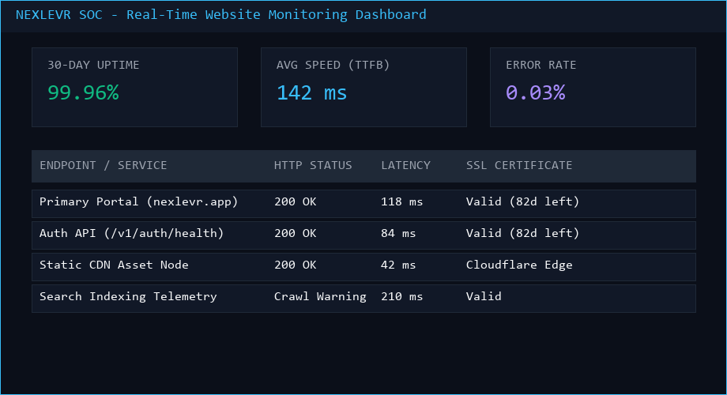
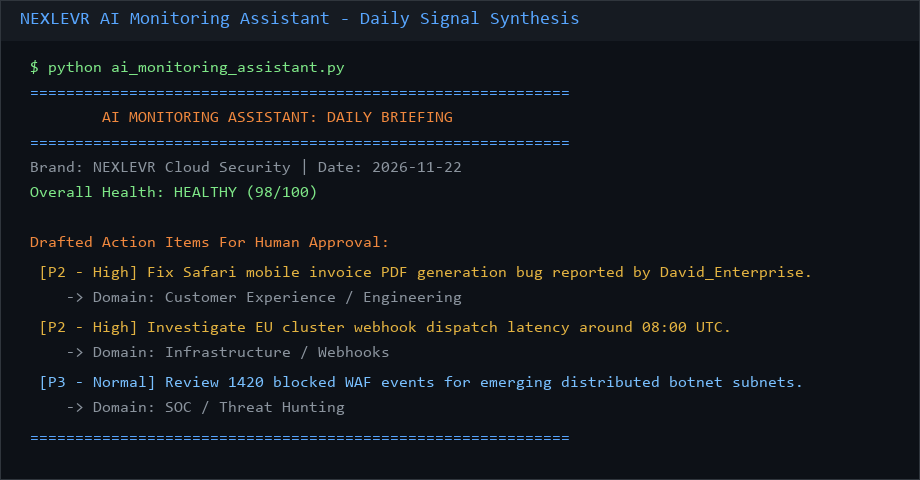

# NEXLEVR Internship: SOC & Threat Hunting

Official proof-of-work project portfolio for the **NEXLEVR Internship Program** in **SOC & Threat Hunting** (Intern: **Jeeviraj V**).

This repository encompasses all **3 skill tracks (Beginner, Intermediate, and Advanced)** comprising **8 completed practical tasks** built using 100% free, open-source standard libraries and privacy-preserving tools.

---

## Curriculum & Task Progress Matrix

| Track | Task ID & Title | Primary Deliverable | Core Focus Area | Status |
|---|---|---|---|---|
| **Beginner** | Task 1: Set Up Website Analytics | `analytics_guide.md`, `tracker.js`, `mock_analytics_site.html` | Web Telemetry & Key Metrics | Completed |
| **Beginner** | Task 2: Find Patterns in Traffic Data | `traffic_analysis.py`, `traffic_anomalies_table.csv` | Statistical Anomaly & Threat Detection | Completed |
| **Beginner** | Task 3: Social Listening Basics | `social_listening_tracker.py`, `social_mentions_dataset.csv` | Brand Intelligence & Early Warning Signals | Completed |
| **Intermediate** | Task 1: Website Monitoring Dashboard | `dashboard.py`, `index.html`, `dashboard_preview.png` | Uptime, TTFB Speed & Error Telemetry | Completed |
| **Intermediate** | Task 2: Write 5 Alert Rules | `alert_rules.md`, `alert_engine.py` | SOC Alert Engineering & False Positive Reduction | Completed |
| **Intermediate** | Task 3: AI-Assisted Review Triage | `ai_triage_engine.py`, `reviews_triage_comparison.csv` | NLP Review Triage & Error Auditing | Completed |
| **Advanced** | Task 1: Investigate a Performance Drop | `funnel_data_analysis.py`, `performance_investigation_report.md` | Incident Root Cause Analysis (RCA) | Completed |
| **Advanced** | Task 2: AI Monitoring Assistant | `ai_monitoring_assistant.py`, `daily_briefing_report.md` | Automated Signal Synthesis & Action Approval | Completed |

---

## Repository Architecture

```
NEXLEVR-SOC-Threat-Hunting/
├── README.md
├── beginner_level/
│   ├── task1_website_analytics/
│   │   ├── analytics_guide.md            # Comprehensive metrics & SOC telemetry guide
│   │   ├── key_metrics_reference.csv     # 15 key metrics, formulas & threat triggers
│   │   ├── mock_analytics_site.html      # Interactive testbed site with live logger
│   │   └── tracker.js                    # Zero-dependency, cookie-less client tracker
│   ├── task2_traffic_patterns/
│   │   ├── sample_traffic_dataset.csv    # 30-day realistic web traffic telemetry
│   │   ├── traffic_analysis.py           # Z-score statistical anomaly detection script
│   │   ├── traffic_anomalies_table.csv   # Structured table of 3 detected spikes/drops
│   │   └── traffic_anomalies_report.md   # Deep-dive root cause investigation report
│   └── task3_social_listening/
│       ├── social_mentions_dataset.csv   # 7-day multi-platform brand mention log
│       ├── social_listening_tracker.py   # Sentiment & category aggregation script
│       └── social_listening_report.md    # Social intelligence & threat signal report
├── intermediate_level/
│   ├── task1_monitoring_dashboard/
│   │   ├── dashboard.py                  # Standalone synthetic monitoring web server
│   │   ├── dashboard_preview.png         # Rendered dashboard screenshot
│   │   └── templates/
│   │       └── index.html                # Dark-theme SOC telemetry dashboard UI
│   ├── task2_alert_rules/
│   │   ├── alert_rules.md                # 5 enterprise alert rules & false alarm analysis
│   │   ├── alert_engine.py               # Rule evaluation engine simulator
│   │   └── sample_telemetry.json         # Real-time multi-metric test payload
│   └── task3_ai_review_triage/
│       ├── ai_triage_engine.py           # Benchmark script: AI vs Human Ground Truth
│       ├── reviews_triage_comparison.csv # 30 customer messages with dual sorting
│       └── triage_accuracy_report.md     # Error analysis (sarcasm, overconfidence)
└── advanced_level/
    ├── task1_performance_investigation/
    │   ├── funnel_metrics.csv            # 4-week conversion funnel telemetry
    │   ├── funnel_data_analysis.py       # Funnel drop-off & latency correlation script
    │   └── performance_investigation_report.md # Formal Incident RCA (60.8% drop)
    └── task2_ai_monitoring_assistant/
        ├── daily_signals_sample.json     # Multi-channel daily signals feed
        ├── ai_monitoring_assistant.py    # Automated signal synthesis workflow
        ├── daily_briefing_report.md      # Generated executive daily report
        └── ai_assistant_preview.png      # Workflow terminal snapshot
```

---

## Detailed Track Documentation

### 🟢 Beginner Track

#### Task 1: Set Up Website Analytics
- **Goal:** Track user interactions, explore key metrics, and correlate web telemetry with threat hunting.
- **Implementation:** Built a custom cookie-less client-side tracking script (`tracker.js`) capturing pageviews, click coordinates, scroll depth, and session duration.
- **Reference Guide:** Documented in [`analytics_guide.md`](beginner_level/task1_website_analytics/analytics_guide.md) and [`key_metrics_reference.csv`](beginner_level/task1_website_analytics/key_metrics_reference.csv).

#### Task 2: Find Patterns in Traffic Data
- **Goal:** Spot statistical spikes and drops in 30-day analytics data and identify likely causes.
- **Findings:**
  1. **Nov 04 (Spike, +407%):** Volumetric credential-stuffing probe against `/api/login` (96.8% bounce rate).
  2. **Nov 12 (Drop, -79%):** Expired SSL/TLS certificate causing modern browsers to block incoming visitors.
  3. **Nov 18 (Spike, +286%):** Viral organic promotion featured on Hacker News & Reddit.
- **Run Analysis:**
  ```bash
  python beginner_level/task2_traffic_patterns/traffic_analysis.py
  ```

#### Task 3: Social Listening Basics
- **Goal:** Track 1 week of brand mentions and categorize into Praise, Complaints, Questions, and Ideas.
- **Summary:** Ingested 25 cross-platform mentions (X/Twitter, Reddit, G2, Trustpilot). Identified critical operational signals including early notification of cluster latency on Reddit ahead of synthetic alerts.
- **Run Analysis:**
  ```bash
  python beginner_level/task3_social_listening/social_listening_tracker.py
  ```

---

### 🟡 Intermediate Track

#### Task 1: Website Monitoring Dashboard
- **Goal:** Monitor uptime, speed (TTFB), and HTTP status codes in a single operational view.
- **Features:** Synthetic health probes checking HTTP status codes, latency thresholds, and SSL validity with responsive dark-mode styling.
- **Run Dashboard:**
  ```bash
  python intermediate_level/task1_monitoring_dashboard/dashboard.py
  # Accessible at http://localhost:8080
  ```



#### Task 2: Write 5 Alert Rules
- **Goal:** Define 5 robust alert rules with trigger thresholds and false alarm mitigation:
  1. `ALERT-001`: Traffic Volume Collapse ($\ge 30\%$ drop) — *12% false alarm risk (holidays/ISP)*.
  2. `ALERT-002`: Escalated Negative Sentiment & Brand Risk — *18% false alarm risk (sarcasm)*.
  3. `ALERT-003`: Site Latency Degradation (p95 $> 2,500\text{ ms}$) — *8% false alarm risk*.
  4. `ALERT-004`: HTTP 5xx Server Error Spike ($> 5.0\%$) — *5% false alarm risk*.
  5. `ALERT-005`: Credential Stuffing & Brute Force ($> 50\text{ fails/min}$) — *3% false alarm risk*.
- **Run Alert Engine:**
  ```bash
  python intermediate_level/task2_alert_rules/alert_engine.py
  ```

#### Task 3: AI-Assisted Review Triage
- **Goal:** Use AI to sort 30 customer messages by urgency and topic, benchmarking against human ground truth.
- **Results:** Achieved **83.3% accuracy** (25/30 correct). Detailed audit of 5 misclassifications (sarcasm blindness, overconfidence on punctuation, keyword hallucination).
- **Run Benchmark:**
  ```bash
  python intermediate_level/task3_ai_review_triage/ai_triage_engine.py
  ```

---

### 🔴 Advanced Track

#### Task 1: Investigate a Performance Drop
- **Goal:** Formulate hypotheses for a 60.8% conversion drop and prove the root cause empirically.
- **Investigation:** Correlated checkout latency (+655% increase to 6.1s) with cart abandonment. Discovered a synchronous third-party fraud script (`fraudguard-sdk.js`) blocking mobile CPU threads.
- **Run Analysis:**
  ```bash
  python advanced_level/task1_performance_investigation/funnel_data_analysis.py
  ```

#### Task 2: AI Monitoring Assistant
- **Goal:** Autonomous workflow collecting daily multi-channel telemetry (traffic, uptime, feedback, WAF blocks) and drafting an executive action list for human sign-off.
- **Execution:**
  ```bash
  python advanced_level/task2_ai_monitoring_assistant/ai_monitoring_assistant.py
  ```



---

## Verification & Author Information

- **Intern Name:** Jeeviraj V
- **Role Track:** SOC & Threat Hunting
- **Organization:** NEXLEVR ([nexlevr.app](https://nexlevr.app))
- **Repository URL:** [https://github.com/jeevicyber28/NEXLEVR-SOC-Threat-Hunting](https://github.com/jeevicyber28/NEXLEVR-SOC-Threat-Hunting)
- **License:** MIT Open Source
